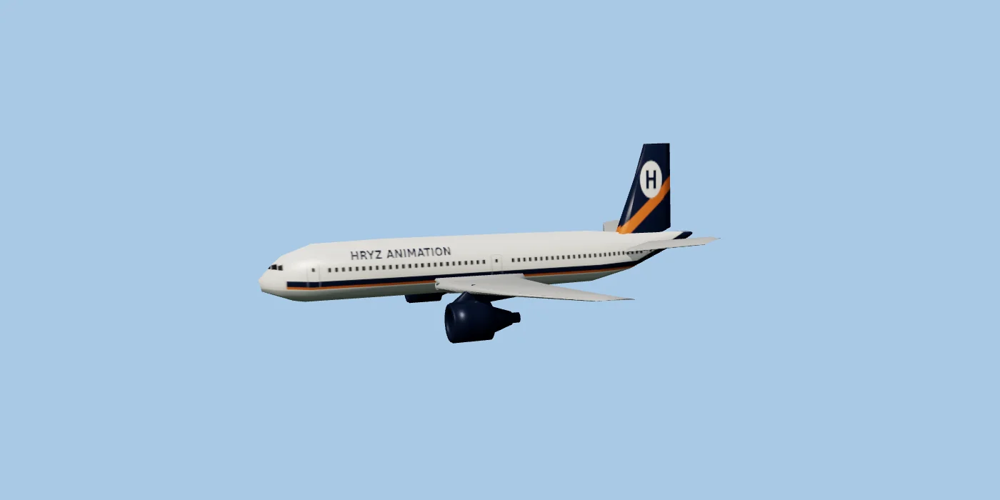
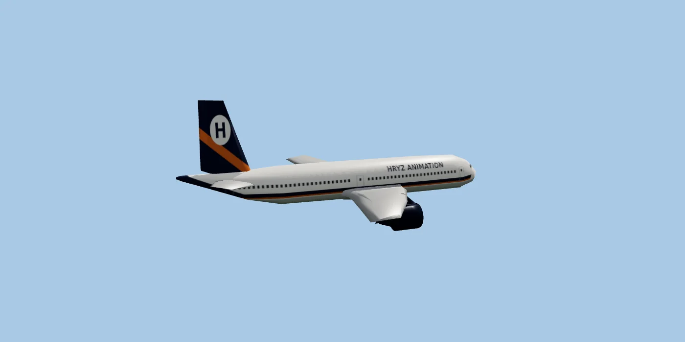
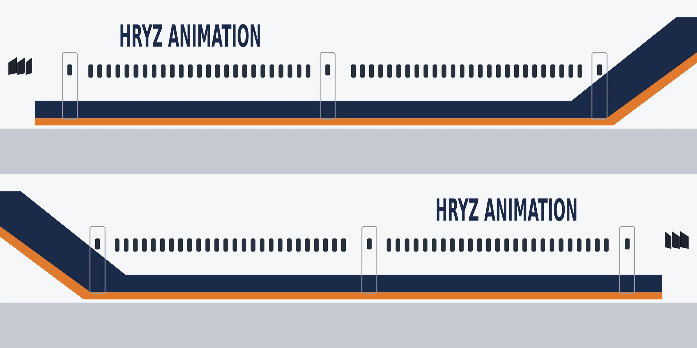

# Jato com a pintura "Hryz Animation"

O `Jetliner.obj` (NuclearOsmosis, **CC0**) nunca teve cores nem coordenadas de textura (o arquivo de materiais não veio no pacote original),
por isso aparecia cinza. `jato-hryz.glb` é o mesmo avião, em metros, com uma **pintura própria da companhia "Hryz Animation"**:

- Fuselagem branca, barriga cinza, faixa azul-marinho com filete laranja que sobe para a cauda (as cores do canal).
- "HRYZ ANIMATION" acima das janelas, **lendo certo dos dois lados**; janelas, três portas e janelas da cabine de comando.
- Cauda azul-marinho com faixa laranja e o "H" do canal num círculo branco. Motores azul-marinho, asas cinza-metálico.
- 40 m de comprimento, 34 m de envergadura. **Nariz para +Z**, origem no centro, eixo da fuselagem em y = 0. Nós: `Fuselagem`, `Cauda`, `Asas`, `Motores`. 705 KB.

A pintura é aplicada por projeção lateral: cada lado do avião usa a sua metade da imagem, por isso o texto nunca sai espelhado.
Refazer: `python3 gerador/aviao_glb.py` (numpy e Pillow). O `Jetliner.obj` original continua aqui sem mudança (o vídeo `voo3d` usa ele).

Fonte do modelo: https://opengameart.org/content/jumbo-jetwide-body (NuclearOsmosis, CC0).
