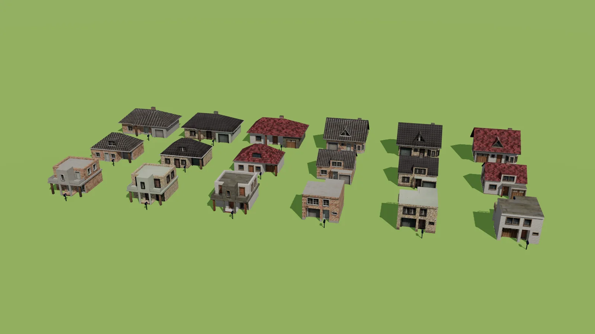
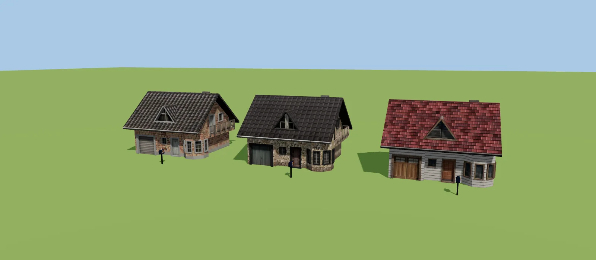
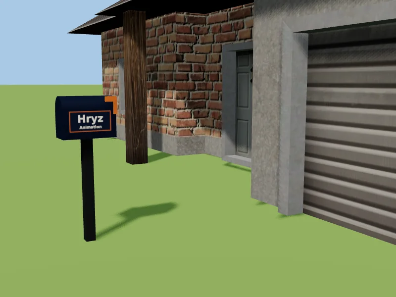

# Casas (drummyfish) com textura e a marca do canal

As 6 casas da coleção *Family House Collection* (drummyfish, **CC0**) convertidas para `.glb` com a **textura embutida**, em metros, e com uma
**caixa de correio "Hryz Animation"** na frente de cada uma. Cada casa sai em **três texturas** (`a`, `b`, `c`): 18 arquivos.





| Arquivo | Tamanho (largura x altura x fundo) |
|---|---|
| `casa1-a/b/c.glb` | 12,3 x 5,6 x 8,2 m (térrea comprida, com garagem e varanda) |
| `casa2-a/b/c.glb` | 8,8 x 6,4 x 8,5 m (sobrado com água-furtada) |
| `casa3-a/b/c.glb` | 8,9 x 5,2 x 6,4 m |
| `casa4-a/b/c.glb` | 7,0 x 5,3 x 7,7 m |
| `casa5-a/b/c.glb` | 6,4 x 5,0 x 7,2 m (moderna, laje e varanda) |
| `casa6-a/b/c.glb` | 6,1 x 4,7 x 6,7 m (moderna, laje) |

- Textura `a`: tijolo à vista e telhado escuro; `b`: pedra e telhado escuro; `c`: madeira/siding claro e telhado vermelho.
- Origem no centro da pegada, chão em y = 0, **porta e garagem viradas para +Z** (o mesmo das casas do kit cidade). Cada arquivo tem de 310 a 430 KB (a maior parte é a textura em JPEG).
- Nós: `Casa` e `CaixaCorreio` (dá para esconder a caixa: `obj.getObjectByName('CaixaCorreio').visible = false`).
- A placa da caixa de correio lê certo dos dois lados (azul-marinho, "Hryz" em branco, filete laranja).

```js
const casa = (await new GLTFLoader().loadAsync('biblioteca3d/casas/casa2-c.glb')).scene;
casa.position.set(x, 0.15, z);          // 0,15 = em cima da grama/calçada do kit cidade
```

## Arquivos de origem e como refazer

- `house1_baked.obj` … `house6_baked.obj`: modelos originais, sem mudança.
- `texturas/casa_a.webp`, `casa_b.webp`, `casa_c.webp`: as texturas assadas originais (`house_a/b/c_bake.png`), guardadas em WebP porque o projeto não versiona `.png`.
- `python3 gerador/casas_glb.py` refaz os 18 GLB e o `manifest.json` (precisa de numpy e Pillow).

Fonte: https://opengameart.org/content/family-house-collection (Miloslav "drummyfish" Číž, CC0). Ver `readme.txt`.
