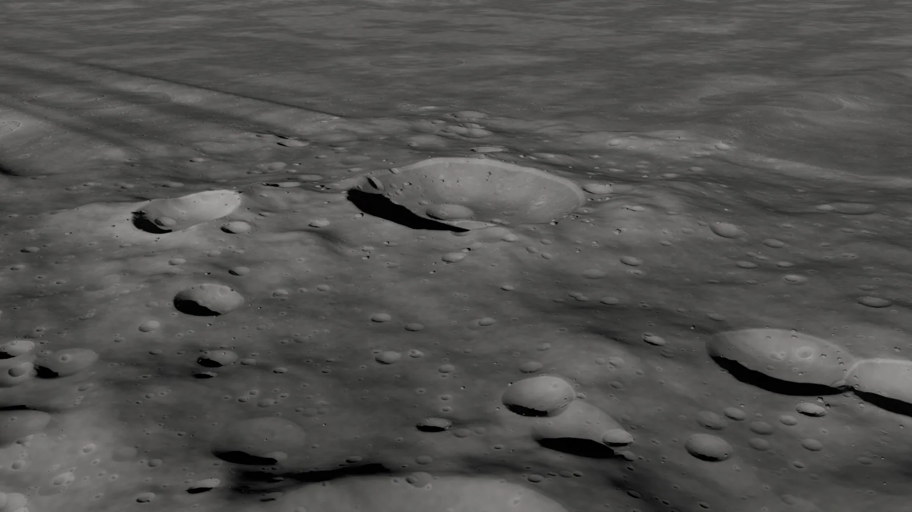
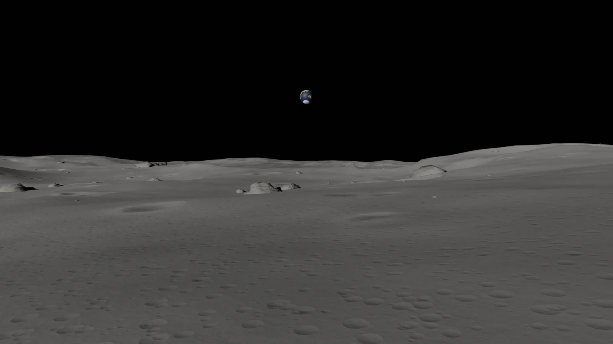

# Lua (cenário e fase do astronauta)

Terreno lunar de 800 m × 800 m feito por script: o relevo e as texturas vêm de `gerar_terreno.py` (numpy) e o Blender monta, exporta e renderiza (`criar_lua.py`).




## Arquivos
| Arquivo | O que é |
|---|---|
| `lua_terreno.glb` (8,8 MB) | `LuaTerreno` (321 × 321 vértices, 2,5 m, albedo 2048 + normal map do detalhe) e `LuaHorizonte` (anel até 6 km com colinas e serras, a mesma textura espelhada) |
| `lua_rochas.glb` | 6 formas de rocha (`Rocha0`…`Rocha5`, ~600 faces, raio 1 m) |
| `rochas.json` | 2.386 rochas `[x, z, tamanho, giro, forma]` em volta das crateras novas e soltas pelo chão |
| `lua_detalhe_normal.jpg` | grão do regolito e microcrateras, repete a cada 4 m (o jogo soma ao normal map) |
| `terra.jpg` | a Terra (Blue Marble, NASA, domínio público) |

## Física usada (com fonte)
- Crateras simples: profundidade ~0,2 do diâmetro e borda ~0,04 (Pike 1977; Melosh, *Impact Cratering*); o ejetado cai com (r/R)^-3 (McGetchin et al. 1973).
- Quantidade: N(>D) ~ D^-2, as pequenas são muito mais numerosas. As velhas ficam rasas e suaves; as novas são claras e têm raios.
- Gravidade 1/6 da Terra (1,62 m/s²): no jogo, 17,5/6 ≈ 2,9 (o jogo usa gravidade "de jogo" na Terra).
- A Terra vista da Lua tem ~2° no céu (raio 85 m a 5 km).

## Refazer
```
python3 gerar_terreno.py
blender -b -P criar_lua.py -- [--render previas --amostras 64 --vistas chao,alto,cratera]
```
O normal map só leva o detalhe que a malha de 2,5 m não tem (altura − desfoque); com o relevo inteiro as sombras dobravam.
