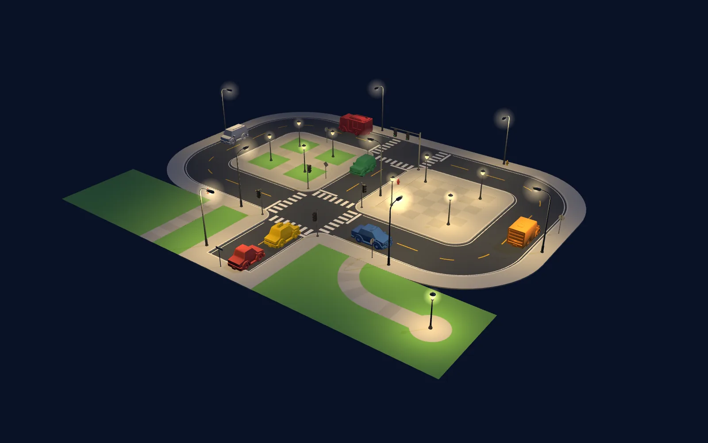
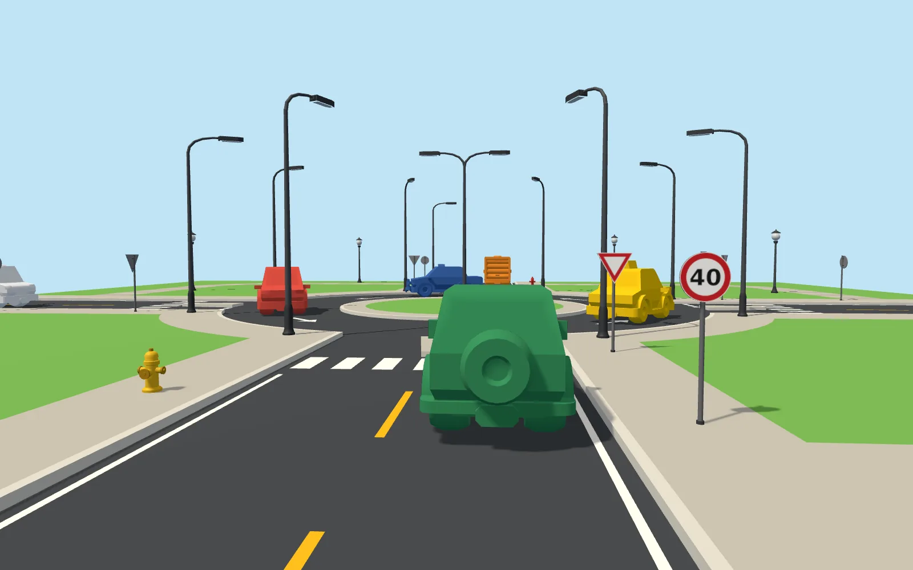
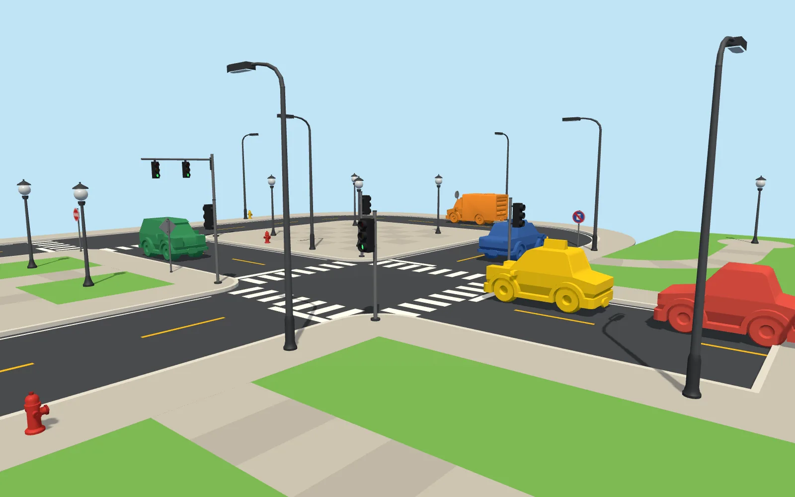
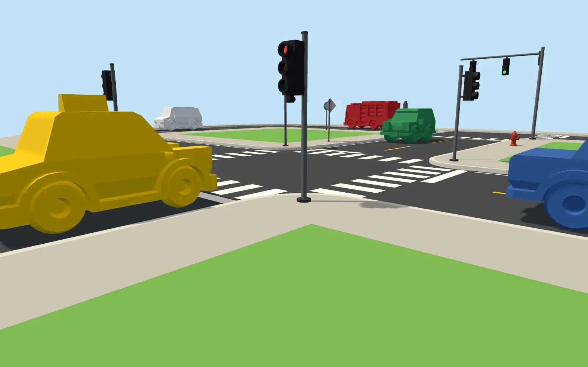

# Kit cidade: ruas, rotatórias, calçadas, faixas, placas, semáforos, postes de luz e hidrantes

Peças 3D modulares, geradas em código, para montar qualquer cenário urbano nos vídeos (Three.js r160) e também em Blender, Unity ou Godot (formato glTF binário, `.glb`).


| | |
|---|---|
|  |  |
|  |  |
|  |  |
|  |  |

- **42 peças**: 5 ladrilhos de rua e o chão de grama, 2 rotatórias, 6 calçadas e caminhos, 6 faixas pintadas, 10 placas, 6 semáforos, 2 hidrantes e 4 postes de luz. Lista completa em [`PECAS.md`](PECAS.md).
- Medidas em **metros reais**, cores chapadas em estilo low poly, no mesmo visual dos veículos do Kenney em `../veiculos/`.
- Cada arquivo tem nós com nome (`Asfalto`, `MeioFio`, `Calcada`, `Grama`, `Faixas`, `Poste`, `Luz`, `Luz_Vermelho`...), então dá para esconder ou recolorir as partes.
- Todas as peças passaram no validador oficial do glTF (Khronos), com 0 erros e 0 avisos.

## Convenções

| Item | Valor |
|---|---|
| Unidade e eixos | metro; Y para cima |
| Ladrilho de rua | 12 x 12 m, origem no centro, encaixe em grade |
| Pista | mão dupla: 2 faixas de 3,5 m = 7 m de asfalto; calçada de 2,5 m em cada lado |
| Alturas | topo do asfalto em y = 0; topo da calçada, dos caminhos e do `chao-grama` em y = 0,15; tinta 0,012 m acima do asfalto |
| Rua reta | corre ao longo de **Z**, a mesma direção da frente dos carros do Kenney; gire 90° em Y para ir em X |
| Conexões | no meio de cada borda: N = −Z, S = +Z, E = +X, W = −X. Girar 90° em Y leva S para E, depois N, depois W |
| Trânsito | **mão direita**: quem anda para +Z usa a faixa x = −1,75; quem anda para −Z usa x = +1,75 |
| Caminhos de pedestres | `calcada-*`: caminho de 2,5 m (lajes de 1,5 m) cortado na grama, com as mesmas conexões das ruas; `calcada-lisa` é uma praça pavimentada inteira |
| Rotatória | `rotatoria`: **36 x 36 m (3 x 3 ladrilhos)**, o centro cai no centro de um ladrilho e as conexões N, E, S, W ficam a 18 m dele; ilha de 6,5 m de raio e anel de 5,5 m, de mão única, **anti-horário** visto de cima. `rotatoria-mini` cabe em 1 ladrilho |
| Frente dos props | **+Z** (lentes do semáforo, bocal do hidrante, face da placa, braço do poste de luz). Para olhar para um carro que anda para +Z, gire 180° em Y |
| Origem dos props | no pé do objeto (y = 0). Sobre a calçada ou a grama do kit, coloque em y = 0,15 |
| Postes de luz | `poste-luz` tem 8,1 m com o braço de 2,4 m para +Z; `poste-luz-pedestre` tem 4,5 m. Cada um traz em `extras.luzes` onde pôr as luzes reais (`pos`, `dir`, `cor`, `alcance`) |
| Veículos do Kenney | escala **1,7** (ficam com 2,55 m de largura numa faixa de 3,5 m) |

As mesmas convenções estão em `manifest.json` (campo `convencoes`), junto com o tamanho, a quantidade de triângulos e as conexões de cada peça.

## Usar no Three.js

```js
import * as THREE from 'three';
import { Kit } from './kit.js';                              // as páginas do canal já usam o importmap do three r160
const kit = await Kit.carregar();                            // lê manifest.json

// ladrilhos na grade (cada casa tem 12 m); `lados` escolhe a rotação pelas conexões desejadas
scene.add(await kit.ladrilho('rua-cruzamento', 0, 0));
scene.add(await kit.ladrilho('rua-reta', 0, 1, 0, ['N', 'S']));
scene.add(await kit.ladrilho('rua-curva', 1, 1, 0, ['W', 'N']));
scene.add(await kit.ladrilho('chao-grama', 1, 0));
scene.add(await kit.ladrilho('calcada-curva', 2, 0, 0, ['W', 'S']));   // caminho de pedestres na grama
scene.add(await kit.ladrilho('rotatoria', 5, 5));                      // rotatória de 36 m: ocupa 3 x 3 casas em volta de (5, 5)

// props em coordenadas locais do ladrilho (x, z); ficam na calçada
const sem = await kit.prop('semaforo-apagado', 0, 0, 4.7, 4.7);    // esquina SE, olhando para quem chega do sul
kit.semaforoEstado(sem, 'vermelho');                               // 'vermelho' | 'amarelo' | 'verde' | 'apagado'
scene.add(sem);
scene.add(await kit.prop('hidrante', 0, 1, 4.8, 0));
scene.add(await kit.prop('placa-pare', 0, 1, -4.8, 3, { rotY: Math.PI }));

// poste de luz em coordenadas do mundo: o braço aponta para +Z, gire em Y para apontá-lo para a pista
const poste = await kit.peca('poste-luz');
poste.position.set(4.8, 0.15, 3); poste.rotation.y = -Math.PI / 2;   // na calçada leste, braço para -X
kit.luzEstado(poste, true);                                          // acende a lâmpada (false apaga)
scene.add(poste);
for (const l of kit.luzesDe(poste)) {                                // à noite, uma luz real por lâmpada
  const luz = new THREE.PointLight(l.cor, l.alcance ** 2 * 1.1, l.alcance * 1.5, 2);
  luz.position.copy(l.pos); scene.add(luz);
}
```

Outras funções do `Kit`: `peca(nome)` (instância solta), `rotacaoPara(nome, lados)` e `naPista(gx, gz, rot, sentido, s)`, que dá a posição de um carro numa faixa. Passe `espelho: true` a `prop()` para o braço do semáforo sair para o outro lado.

Veja duas cenas completas em `demo_cidade.html` e o catálogo em `catalogo.html`. As duas páginas precisam de um servidor HTTP na pasta `videos/`:

```bash
cd videos && python3 -m http.server 8777
# cidade (grade 5 x 4: semáforos, placas, hidrantes, postes, caminhos, praça e sete veículos)
#   http://127.0.0.1:8777/biblioteca3d/cidade/demo_cidade.html?cam=aereo|rua|topo|canto|poste
# rotatória (grade 5 x 5: rotatória de 36 m, quatro braços, caminhos nos cantos e seis veículos)
#   http://127.0.0.1:8777/biblioteca3d/cidade/demo_cidade.html?mapa=rotatoria&cam=aereo|rua|topo|canto|poste
# acrescente &noite para a versão noturna (lâmpadas acesas, uma luz real por poste); &still esconde o texto da página
# câmera livre: &pos=x,y,z&alvo=x,y,z&fov=graus
#   http://127.0.0.1:8777/biblioteca3d/cidade/catalogo.html?cat=ruas|rotatorias|calcadas|faixas|placas|mobiliario&cam=obl|topo|baixo
```

## Veículos do Kenney

Os `.glb` de `../veiculos/` apontam para `Textures/colormap.png`, mas esse PNG **não está no repositório** (o `.gitignore` ignora `*.png`), e por isso os carros aparecem brancos. A demonstração pinta cada carro com uma cor chapada quando a textura não existe e usa a textura original quando ela está presente.

## Regerar e editar

Precisa de Python 3 com `numpy` e `Pillow`.

```bash
python3 biblioteca3d/cidade/gerador/gerar.py      # recria os .glb, o manifest.json e o PECAS.md
python3 biblioteca3d/cidade/gerador/validar.py    # confere faces, normais, medidas dos ladrilhos e da tinta
node biblioteca3d/cidade/gerador/captura.js "demo_cidade.html?still&cam=aereo" saida.png 1600 1000   # foto de uma página (com o servidor ligado; usa Playwright e o three de node_modules, como os outros scripts de render)
```

| Arquivo | O que faz |
|---|---|
| `gerador/glb.py` | escritor de glTF 2.0 binário (materiais PBR, textura PNG embutida, nós com nome e `extras`) |
| `gerador/malha.py` | construtor de malhas: caixas, polígonos (côncavos também), prismas, sólidos de revolução, tubos |
| `gerador/paleta.py` | cores e materiais do kit |
| `gerador/ruas.py` | reta, curva, T, cruzamento e fim de rua (as medidas da pista ficam no topo do arquivo) |
| `gerador/rotatoria.py` | rotatória de 36 m e mini-rotatória (raios da ilha, do anel e da calçada no topo do arquivo) |
| `gerador/calcadas.py` | praça pavimentada e caminhos de pedestres (reta, curva, T, cruzamento, fim) |
| `gerador/faixas.py` | tracejado, linha dupla, bordas, faixa de pedestres, linha de retenção, seta |
| `gerador/placas.py` + `texturas.py` | placas: poste, chapa e a face desenhada com Pillow |
| `gerador/mobiliario.py` | semáforos e hidrantes |
| `gerador/iluminacao.py` | postes de luz (simples, apagado, duplo e de pedestre) e a lista de luzes de cada um |
| `gerador/gerar.py` | gera tudo e escreve o manifest |

**Para criar uma peça nova:** escreva uma função que devolva uma `Malha` (ou uma lista de `(nome_do_nó, Malha)`), registre-a no dicionário `PECAS` do módulo, rode `gerar.py` e depois `validar.py`. Para mudar a largura da pista ou da calçada, altere `H`, `S` e `TILE` no topo de `ruas.py` e rode `gerar.py` de novo.

## O que ainda não tem

Rampa de garagem, lombada e faixa elevada, pista de 4 faixas e avenida com canteiro, rotatória de duas faixas, ônibus e ponto de ônibus, árvores e prédios, trânsito pela esquerda, faixas e setas curvas. O cone está em `../veiculos/cone.glb`.

## Licença

Gerado em código para o canal Hryz Animation: uso livre nos vídeos, sem precisar dar crédito. O desenho das placas segue o padrão brasileiro de sinalização (CONTRAN) de forma simplificada.
