# Kit Egito: pirâmides de Gizé e a Grande Esfinge

Modelos 3D gerados em código para o canal (uso livre), em `.glb` (glTF binário), no mesmo estilo low poly de cores chapadas do kit `../cidade/`. Medidas em **metros reais**, Y para cima.

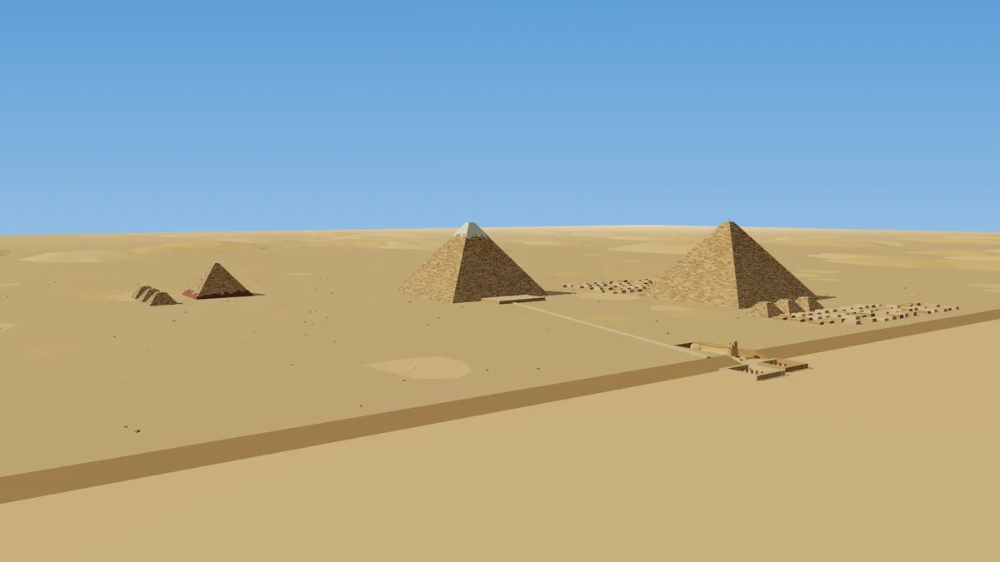
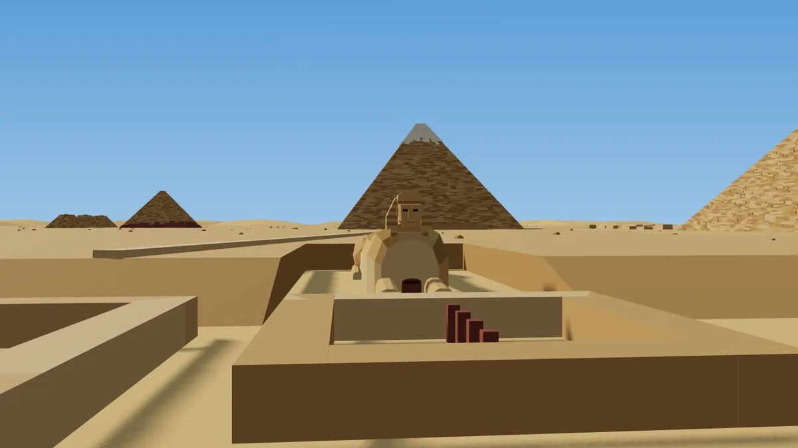

| Arquivo | O que é | Medidas | Triângulos |
|---|---|---|---|
| `piramide-queops.glb` | Grande Pirâmide (Quéops/Khufu) **como está hoje**: fiadas de blocos em degraus, tons sorteados, alguns blocos faltando, plataforma no topo com blocos soltos e a haste que marca a altura original | base 230,3 m, altura 138,5 m | 30.720 |
| `piramide-queops-original.glb` | a mesma **recém-terminada** (~2560 a.C.): revestimento liso de calcário branco, ponta dourada e a entrada na face norte (−Z) | base 230,3 m, altura 146,6 m | 14 |
| `piramide-quefren.glb` | Quéfren (Khafre), com o **revestimento liso que sobrou no topo** (borda quebrada) | base 215,3 m, altura 136,4 m | 28.690 |
| `piramide-miquerinos.glb` | Miquerinos (Menkaure), com a **base de granito vermelho** | base 103,4 m, altura 61 m | 11.828 |
| `piramide-rainha.glb` | pirâmide de rainha (satélite), arruinada | base 46 m, altura 20 m | 2.700 |
| `esfinge.glb` | **Grande Esfinge**: corpo de leão deitado, patas com dedos, cauda no quadril direito, rosto com o nariz quebrado, nemes listrado com abas e rabicho, e a Estela do Sonho de granito entre as patas. **Rosto olhando para +Z** | 73 x 20 x 19 m | 1.230 |
| `planalto-gize.glb` | tudo montado nas **posições reais** (tiradas da latitude e longitude): as 3 pirâmides, 6 pirâmides de rainhas, a Esfinge no fosso olhando para o leste, Templo da Esfinge e Templo do Vale, templos funerários, calçada de Quéfren, campos de mastabas, manchas de areia, pedras e dunas | chão de 10 x 10 km | — |

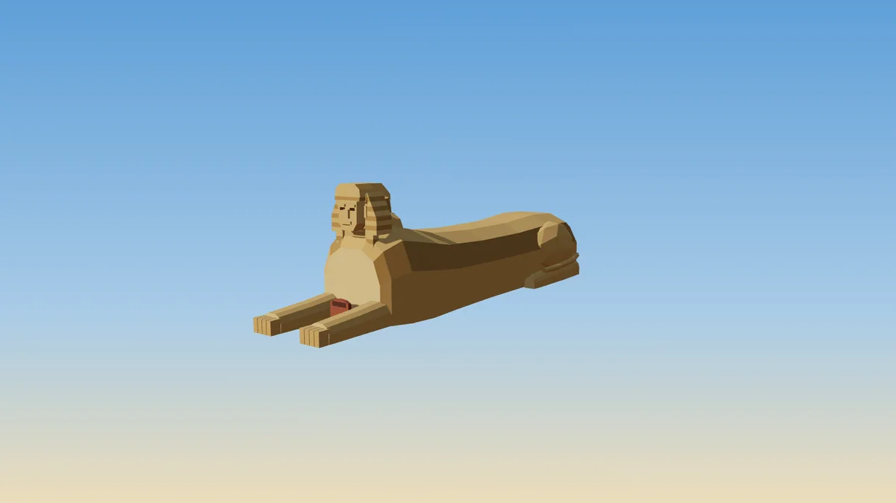
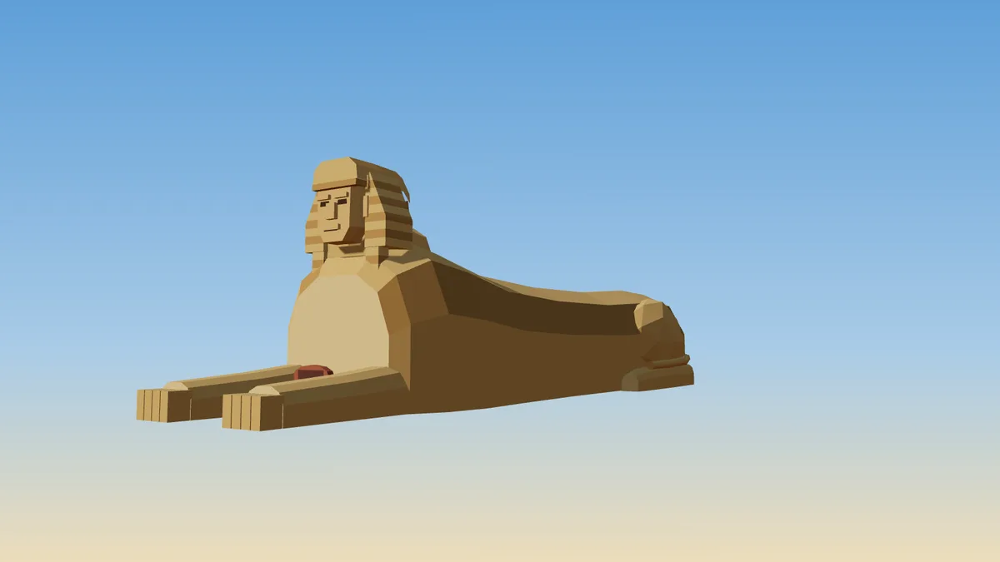

| | |
|---|---|
| 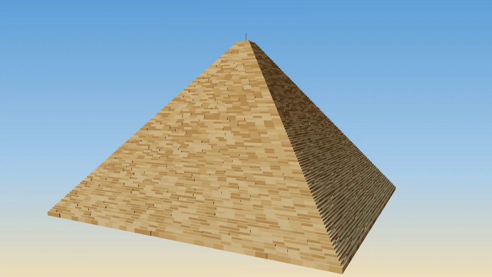 | 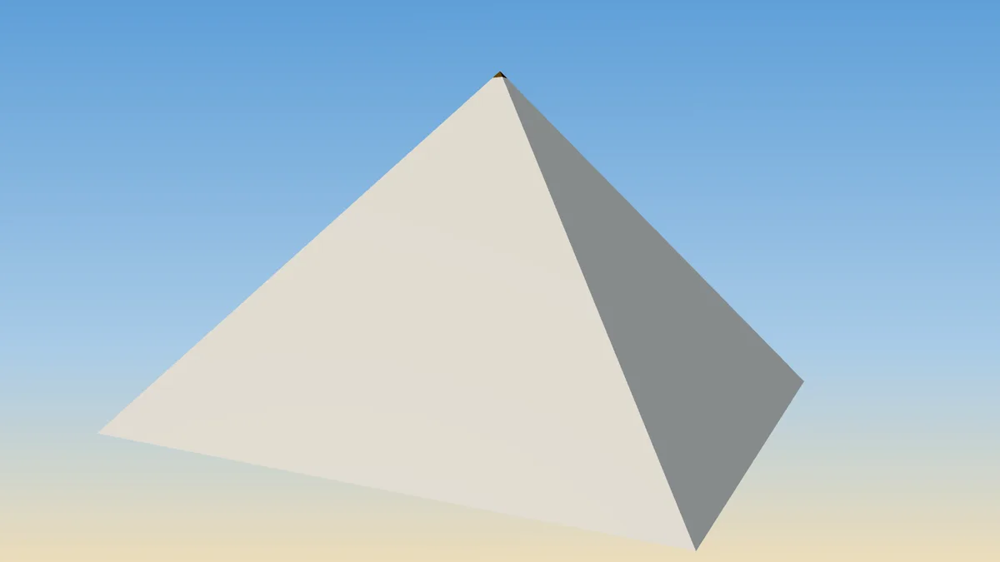 |
| 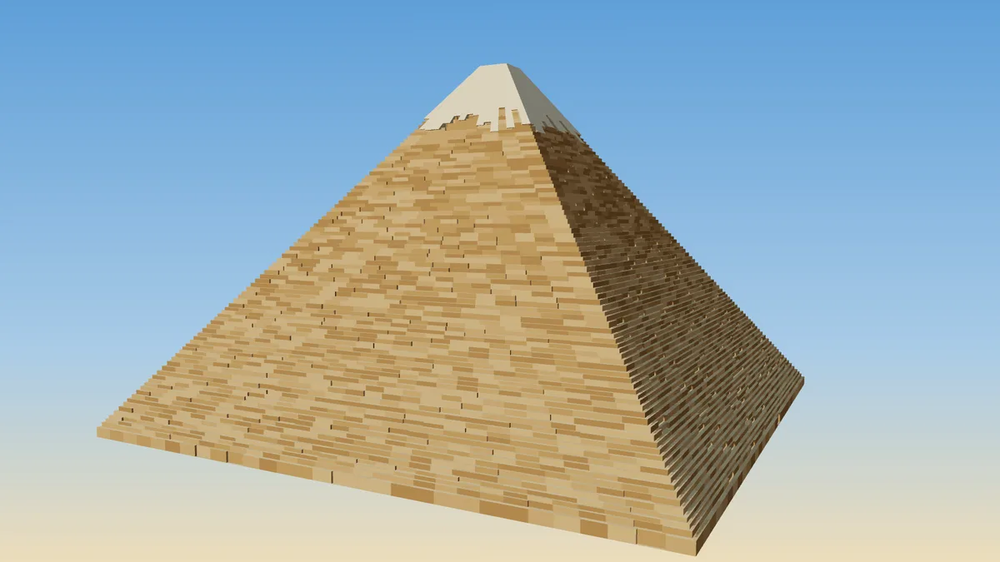 | 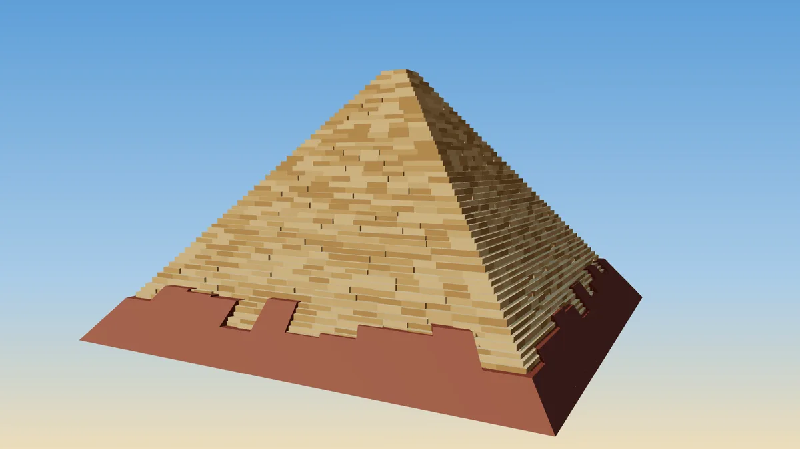 |
| 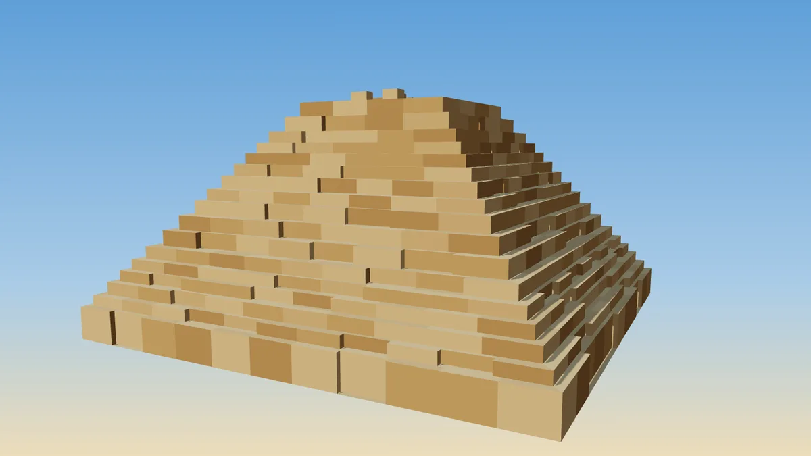 | 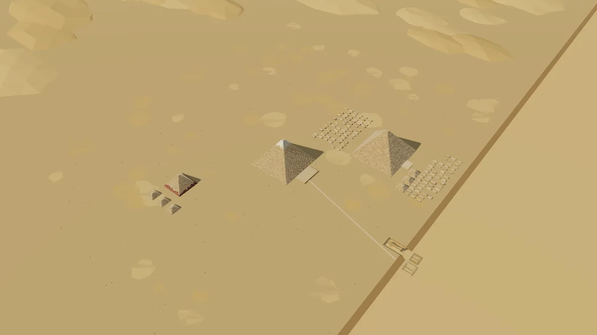 |
| 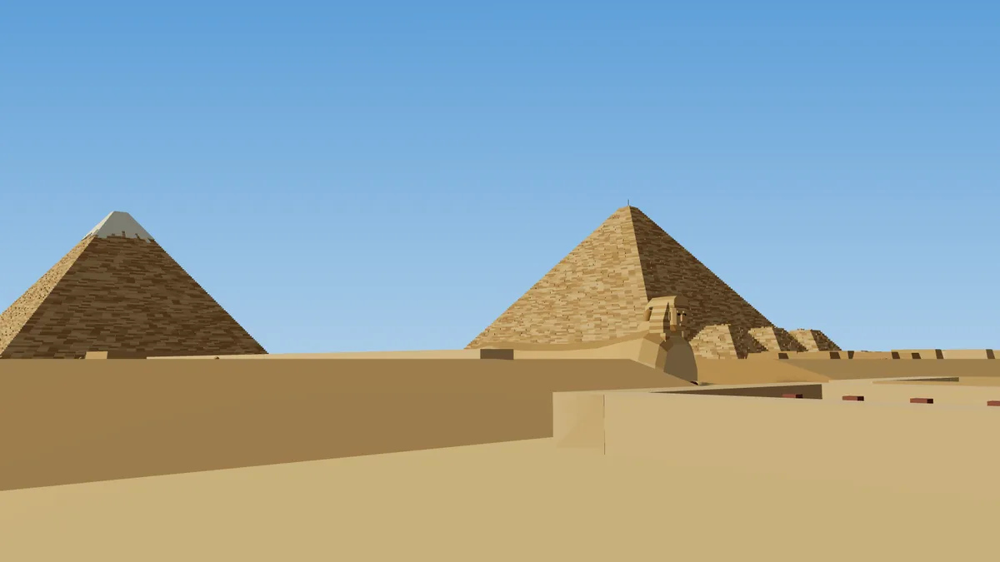 | |

## Convenções

| Item | Valor |
|---|---|
| Unidade e eixos | metro; Y para cima |
| Origem das peças | centro da base, pé em y = 0 (as pirâmides descem 2 m abaixo do chão como fundação, para assentar em terreno irregular) |
| Lados das pirâmides | alinhados com X e Z (as reais estão alinhadas com os pontos cardeais) |
| Esfinge | rosto para **+Z**; no planalto ela está girada 90° para olhar para +X (leste) |
| Planalto | **norte = −Z, leste = +X**; Quéops no centro (0, 0); o planalto fica em y = 0 e o fosso da Esfinge e o vale a leste em y = −8 (encosta de 26 m entre os dois) |
| Posições no planalto | Quéfren (−328, 344), Miquerinos (−588, 743), Esfinge (328, 432); todas em `manifest.json` (`posicoes_no_planalto`) |
| Nós com nome | `Degraus`, `Revestimento`, `Granito`, `Topo`, `Entrada`; na Esfinge `Corpo`, `Patas`, `Cabeca`, `Rosto`, `Nemes`, `Estela`; no planalto `Chao`, `Dunas`, `Pedras`, `Mastabas`, `Templos` e um grupo por monumento (`Queops`, `Quefren`, `Miquerinos`, `Rainha1`…`Rainha6`, `Esfinge`) — dá para esconder ou recolorir as partes |
| Materiais | `Calcario*`, `Revestimento`, `RevestimentoNovo`, `Ouro`, `Granito*`, `Esfinge*`, `Nemes*`, `Areia*`, `RochaChao`, `RochaParede` |

Escala com os personagens: o `corredor` e o `elenco` têm ~1,78 m, então um personagem na base da Grande Pirâmide é do tamanho de um bloco da primeira fiada (cada fiada tem ~1,45 m).

## Usar no Three.js (r160)

```js
import { GLTFLoader } from 'three/addons/loaders/GLTFLoader.js';
const loader = new GLTFLoader();
const esfinge = (await loader.loadAsync('biblioteca3d/egito/esfinge.glb')).scene;
esfinge.traverse(o => { if (o.isMesh) { o.castShadow = o.receiveShadow = true; } });
scene.add(esfinge);

// planalto inteiro e um personagem ao pé da Esfinge (ela está em (328, -8, 432), olhando para +X)
const gize = (await loader.loadAsync('biblioteca3d/egito/planalto-gize.glb')).scene;
scene.add(gize);
corredor.position.set(328 + 45, -8, 432);
// esconder uma parte: gize.getObjectByName('Mastabas').visible = false;
```

Câmera: o planalto tem 10 km de chão; use `near` ≥ 0,5 e `far` ~20 000, e névoa (`THREE.Fog('#e6d6b6', 2500, 9000)`) para o horizonte. Sombras: sol de sudoeste, câmera de sombra do tamanho da área enquadrada.

## Visualizador e prévias

- `egito.html?modelo=esfinge&cam=frente|lado|alto|chao` (servir `videos/` por HTTP: `python3 -m http.server 8777`).
- Prévias: `node gerador/captura.js "egito.html?modelo=planalto-gize&cam=lado&still" saida.png 1600 900` (precisa de `npm install` em `videos/`).

## Gerar de novo

```
python3 gerador/egito.py
```

Só precisa de `numpy`; reaproveita `malha.py` e `glb.py` do kit cidade. As fiadas e os blocos são sorteados com semente fixa, então o resultado é sempre o mesmo. Para mudar o tamanho dos blocos, a altura das fiadas ou a quantidade de blocos faltando, veja os parâmetros de `degraus()`.

## Fontes das medidas

Medidas e alturas como aparecem nas referências usuais (Wikipedia, verbetes *Great Pyramid of Giza*, *Pyramid of Khafre*, *Pyramid of Menkaure*, *Great Sphinx of Giza*): Quéops 230,3 m de base, 146,6 m originais e 138,5 m hoje; Quéfren 215,3 m, 143,5 m originais e 136,4 m hoje; Miquerinos ~103 m, 65,5 m originais e 61 m hoje; Esfinge 73 m de comprimento, 20 m de altura e 19 m de largura. As posições no planalto vêm das coordenadas de cada monumento e são **aproximadas** (erro de alguns metros); os templos, a calçada e os campos de mastabas são simplificados, não plantas arqueológicas.
