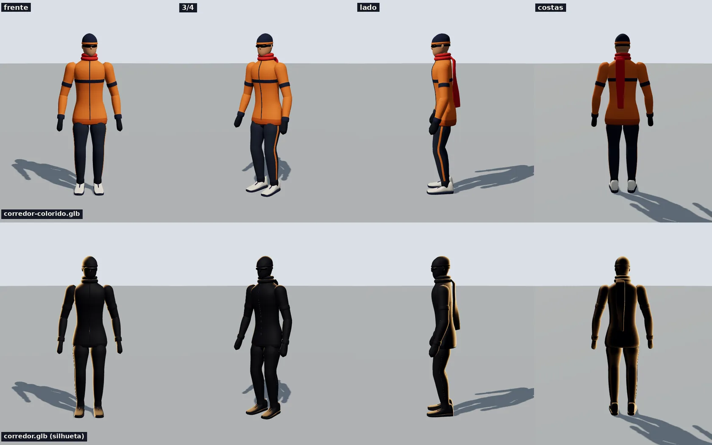
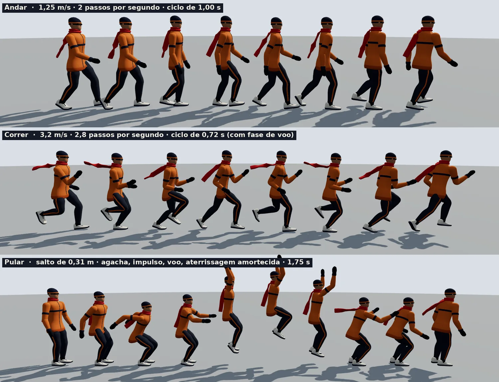
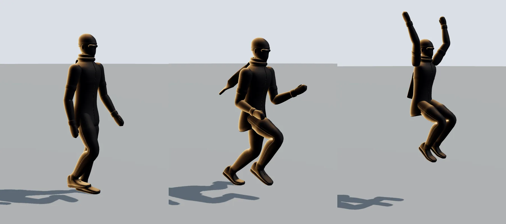

# Corredor — personagem 3D com esqueleto e animações

Personagem **original do canal** (Hryz Animation), feito em código: humano adulto de 1,82 m, esqueleto de 29 ossos e quatro animações
prontas (**Parado, Andar, Correr, Pular**). Uso livre em qualquer vídeo, sem crédito.
Sem rosto de propósito (regra do canal: silhueta escura e proporção natural); a viseira esportiva dá a direção do olhar.



| Arquivo | O que é |
|---|---|
| `corredor.glb` | **silhueta**: corpo inteiro azul-marinho quase preto (`#151925`, o mesmo dos bonecos silhueta do canal). Combina com `silhueta()`, que acende a borda de luz quente |
| `corredor-colorido.glb` | versão colorida: jaqueta laranja com faixas e zíper, calça grafite com listra laranja, tênis branco, luvas, gorro azul, viseira e cachecol vermelho |
| `corredor.js` | ajudante em Three.js (carregar, tocar animação, silhueta, contorno, clonar) |
| `corredor.html` | visualizador: botões dos clipes, chão que corre na velocidade do clipe (mostra que os pés não escorregam) |
| `previews/` | imagens e ciclos animados (WebP) |
| `gerador/` | código que gera tudo (`gerar.py`), valida (`validar.py`) e refaz as prévias (`previas.py`) |

40.112 triângulos, 21 mil vértices, 1,5 MB cada GLB. Cada clipe tem o desenho dos movimentos no `previews/corredor-poses.webp`.

## Uso rápido (Three.js r160)

```js
import { Corredor } from './corredor.js';

const eu = await Corredor.carregar('corredor.glb');   // ou 'corredor-colorido.glb'
eu.silhueta();                                        // só na versão escura: borda de luz quente (opcional)
scene.add(eu.obj);
eu.tocar('Correr');                                   // 'Parado' | 'Andar' | 'Correr' | 'Pular'

// no laço de animação:
eu.atualizar(dt);                                     // anima o esqueleto
eu.obj.position.z += eu.info('Correr').velocidade * dt;   // e move o personagem (os clipes são "no lugar")
```

Servir por HTTP (`python3 -m http.server`) e abrir `corredor.html` (parâmetros no fim deste arquivo).

| Método | O que faz |
|---|---|
| `Corredor.carregar(url)` | carrega o GLB (devolve o personagem; `eu.obj` é o objeto para pôr na cena, `eu.clipes` a lista de animações) |
| `eu.tocar(nome, { fade = 0.25, velocidade = 1, loop = true })` | começa ou troca de clipe com fusão suave |
| `eu.pose(nome, t)` | congela na pose do instante `t` (s) do clipe |
| `eu.atualizar(dt)` | avança as animações (chamar a cada quadro) |
| `eu.info(nome)` | dados do clipe: `duracao`, `laco`, `velocidade` (m/s), `passada_m`, `passos_por_s` |
| `eu.clonar()` | outro personagem independente (esqueleto e animação próprios) para multidão |
| `eu.silhueta({ borda, forca, potencia, luz })` | borda de luz quente (Fresnel) só no lado que olha para `luz` (vetor de mundo, padrão atrás à esquerda); funciona com qualquer iluminação |
| `eu.contorno({ cor, espessura })` | contorno de desenho animado (casca invertida), 6 mm por padrão |

## As animações

Todas são **no lugar**: o personagem não sai do lugar, quem se desloca é o `eu.obj`. Andando na velocidade do clipe os pés não escorregam.
Os pés de apoio ficam parados no chão (medido: 0,00 mm por quadro no andar e no correr).

| Clipe | Duração | Repete | Velocidade | Detalhes |
|---|---|---|---|---|
| `Parado` | 4,00 s | sim | 0 | respira, troca o peso de perna, olha em volta, cachecol balança |
| `Andar` | 1,00 s | sim | 1,25 m/s | 2 passos por segundo (passada de 1,25 m); calcanhar → pé chato → sai na ponta; braços contra as pernas |
| `Correr` | 0,72 s | sim | 3,2 m/s | 2,8 passos por segundo; tem fase de voo (os dois pés no ar); inclina o tronco 11°, cotovelos a 90°, calcanhar sobe até 0,49 m |
| `Pular` | 1,75 s | não (começa e termina de pé) | 0 | agacha, impulso nos dedos, voo de 0,52 s (sobe 0,31 m) com pernas recolhidas e braços para cima, aterrissa amortecendo |



Para o personagem andar de verdade pela cena: `velocidade` em m/s na direção que ele olha (+Z do objeto). Para mudar o ritmo,
`eu.tocar('Andar', { velocidade: 1.4 })` e multiplique a velocidade de deslocamento pelo mesmo fator.
Troca entre clipes (`Parado` → `Andar` → `Correr`) usa fusão de 0,25 s. O `Pular` é um salto parado (com agachamento antes); pulo em movimento ainda não existe.

### Silhueta com borda de luz quente



`corredor.glb` + `eu.silhueta()` dá o visual dos shorts de silhueta do canal em 3D: corpo escuro e uma borda quente (`#ffc27a`) no lado da luz.

## Coordenadas e esqueleto

- Metros, Y para cima, o personagem **olha para +Z** e o lado **esquerdo dele é +X** (igual ao kit da cidade). Pés em y = 0, origem entre os pés.
- Sem escala: 1 unidade = 1 m. Altura 1,82 m com gorro.
- Pose de repouso em "A" (braços relaxados, cotovelo e joelhos levemente dobrados). **Todos os ossos têm rotação de repouso = identidade**
  (eixos alinhados ao mundo); a posição de repouso de cada osso é a da sua junta.
  Girar em X positivo inclina para frente o que aponta para cima (tronco) e joga para trás o que pende (perna, braço).

```
Raiz (no chão, entre os pés; fica parada nos clipes)
└ Quadril ── Coluna ── Coluna2 ── Peito ─┬─ Pescoco ── Cabeca
   │                                     │      └ Cachecol1 … Cachecol6   (rabo do cachecol)
   │                                     ├─ OmbroE ── BracoE ── AntebracoE ── MaoE
   │                                     └─ OmbroD ── BracoD ── AntebracoD ── MaoD
   ├─ CoxaE ── CanelaE ── PeE ── PonteiraE
   └─ CoxaD ── CanelaD ── PeD ── PonteiraD            (E = esquerda = +X · D = direita)
```

Segurar objetos: `eu.obj.getObjectByName('MaoD').add(objeto)`. O osso da mão tem eixos do mundo no repouso; o punho fica a ~ (0,33, 0,89, 0,13) do centro.
O objeto segue a mão em qualquer clipe.

## Visualizador (`corredor.html`)

Parâmetros da URL: `f` (arquivo GLB), `clip`, `t` (congela no instante), `az`/`el`/`d`/`alvo`/`fov` (câmera), `folha=N` (N poses do ciclo lado a lado) e `eixo=z`/`esp`,
`fundo`/`chao` (cores hex sem #), `semgrade` (esconde as faixas do chão), `rim` / `semrim` (liga/desliga a borda quente; liga sozinha em `corredor.glb`),
`contorno` (liga o contorno; `contorno=ff8800` escolhe a cor), `ocultar=Nome1,Nome2`, `still` (sem botões nem laço de animação).
Exemplo: `corredor.html?f=corredor-colorido.glb&clip=Correr&az=-50&d=4.4&alvo=0,0.9,0`.

## Como foi feito (e como refazer)

Tudo em Python (numpy e Pillow) a partir de `gerador/`; o escritor de GLB é o do kit da cidade (`../../cidade/gerador/glb.py`, estendido com esqueleto e animação).

| Passo | Comando | O que faz |
|---|---|---|
| gerar | `python3 gerar.py` | monta esqueleto, malha com pesos de pele e animações e grava os dois GLB |
| validar | `python3 validar.py` | lê o **arquivo** GLB e confere pesos, quaternions, laços, pés no chão, escorregão e limites de articulação |
| prévias | `python3 previas.py` | refaz `previews/` (precisa de `npm install` em `videos/` e Chromium via Playwright) |

- **Malha** (`modelo.py`): superfícies por seções (anéis de superelipse suavizados por Catmull-Rom) para tronco, cabeça, pernas, braços, tênis e luvas; pesos de pele por interpolação entre juntas
  (4 influências por vértice); a barra da jaqueta acompanha a coxa que levanta; materiais por região (16 na versão colorida, 2 na silhueta).
- **Marcha** (`animacoes.py`): IK de duas juntas nas pernas com o pé de apoio preso ao chão (calcanhar, depois pé chato, depois junta da ponteira); o pé sobe sozinho quando a perna não alcança;
  balanço em curva de Hermite com as velocidades das pontas do apoio; pelve sobe e desce, balança e gira; tronco gira contra a pelve; cabeça se estabiliza; braços contra as pernas.
- **Pulo**: curva balística (g = 9,81) entre a decolagem e o pouso, com impulso nos dedos e pernas recolhidas no ar.
- **Cachecol**: cadeia de partículas com gravidade, arrasto do ar quadrático e colisão com as costas, simulada por vários ciclos e fundida para repetir sem emenda; a fita gira em torno do próprio eixo.

Validação atual: **Khronos glTF Validator: 0 erros, 0 avisos**; checagens próprias: início = fim em todos os laços, pés nunca atravessam o chão (0,0 mm),
escorregão máximo 0,00 mm/quadro (andar e correr) e 0,35 mm (pulo), joelho de 5° a 121°, cotovelo de 0° a 83°.

## Limites e próximos passos possíveis

- O pulo é **parado** (salto vertical). Dá para acrescentar pulo correndo, corrida rápida (sprint), curva, sentar, acenar, tropeçar e cair.
- Mãos são luvas fechadas (sem dedos animados) e o rosto é liso de propósito.
- Não há `Contorno` dentro do GLB: ele é criado em tempo de execução por `eu.contorno()`.
