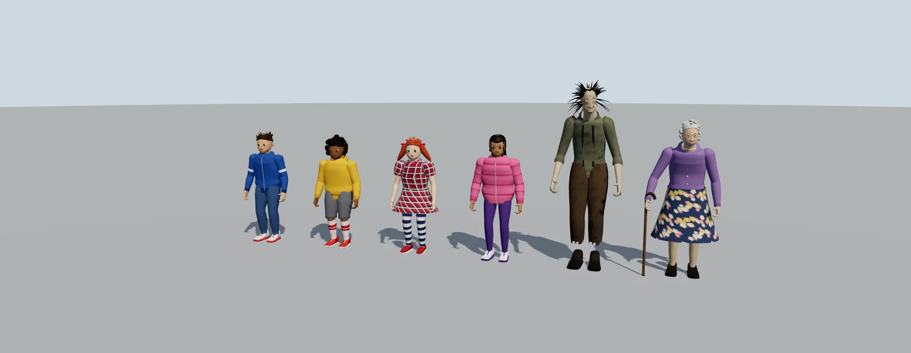
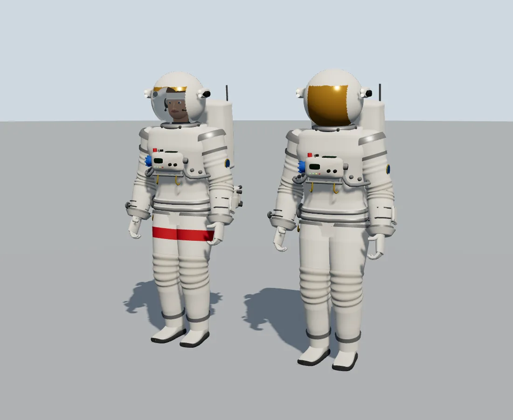
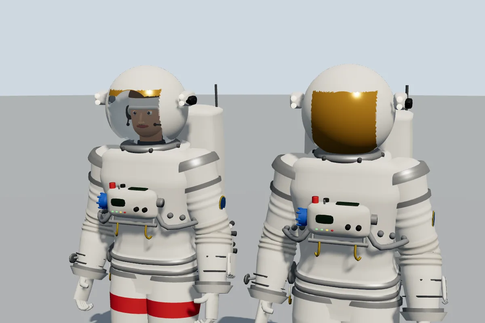
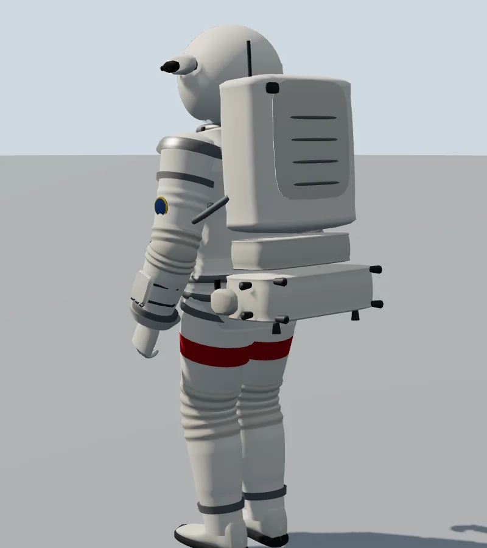
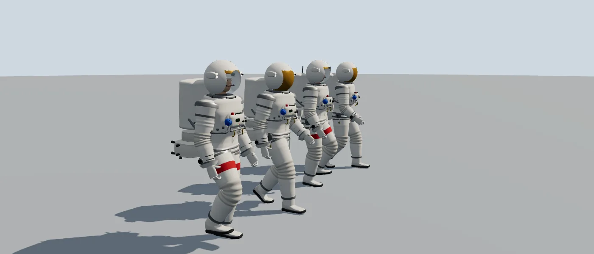
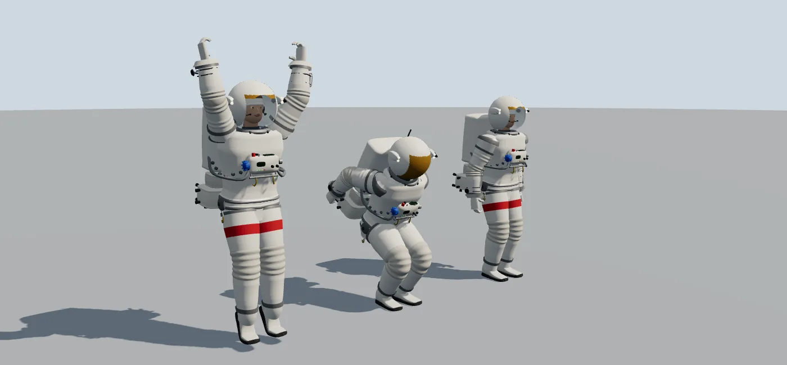
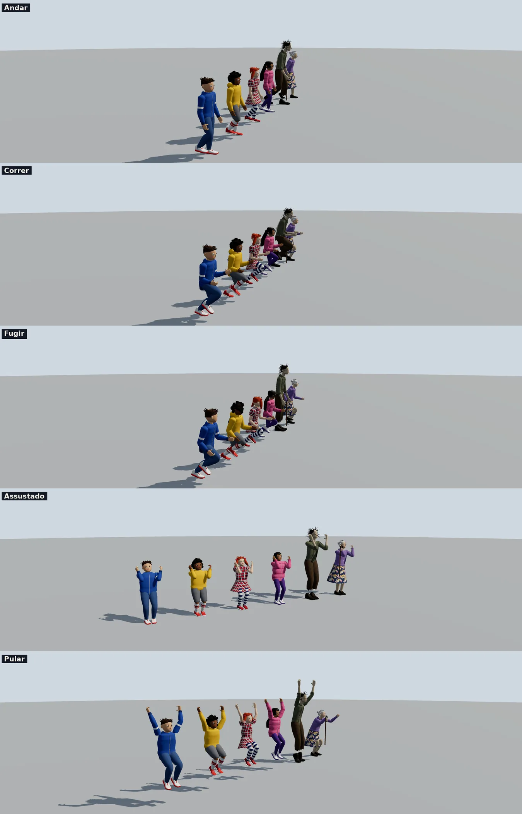
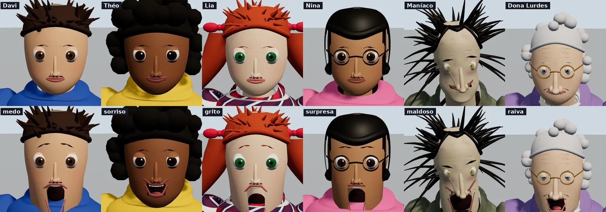
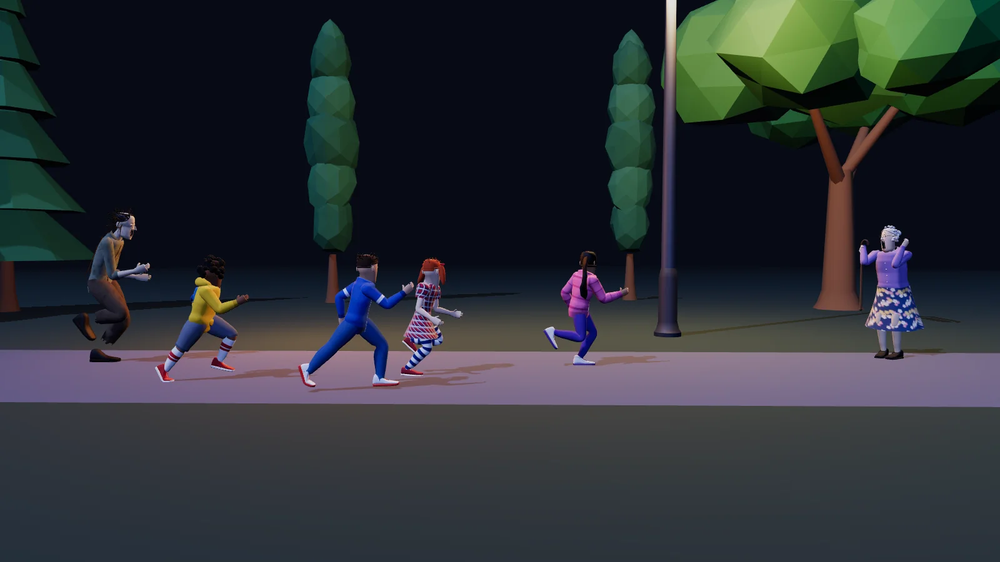

# Elenco — maníaco, velha senhora e quatro crianças (3D, com rosto que mexe)

Seis personagens **originais do canal** (Hryz Animation), feitos em código, prontos para uma cena de susto: o **maníaco**, **Dona Lurdes** (a velha senhora),
dois meninos (**Davi** e **Théo**) e duas meninas (**Lia** e **Nina**), cada criança com cabelo e roupa diferentes.
Todos têm esqueleto, **rosto que mexe** (olhos, pálpebras, sobrancelhas, boca com dentes e língua) e animações prontas. Uso livre, sem crédito.



| Arquivo | Nome | Altura | Triângulos | Quem é |
|---|---|---|---|---|
| `davi.glb` | Davi | 1,31 m | 53.802 | menino de 9 anos, cabelo castanho curto e arrepiado, jaqueta azul de zíper com faixas, jeans e tênis branco com sola vermelha |
| `teo.glb` | Théo | 1,27 m | 57.153 | menino de 8 anos, cabelo afro preto, moletom amarelo com capuz e bolso canguru, bermuda cinza, meias altas listradas, tênis vermelho e mochila azul |
| `lia.glb` | Lia | 1,29 m | 55.702 | menina de 9 anos, ruiva de maria-chiquinhas com laços (cabelo simulado), vestido xadrez com gola branca, meia-calça listrada e sapatinho vermelho |
| `nina.glb` | Nina | 1,36 m | 56.854 | menina de 10 anos, cabelo preto liso comprido com franja (simulado), óculos redondos, casaco puffer rosa, legging roxa e tênis branco |
| `maniaco.glb` | Maníaco | 1,88 m | 55.488 | homem magro e corcunda, rosto encovado com olheiras, barba por fazer, nariz de gancho, dentes tortos e cicatriz, cabelo selvagem e oleoso, camisa suja e rasgada, suspensórios, calça puída e botas |
| `velha.glb` | Dona Lurdes | 1,56 m | 61.115 | senhora de 78 anos, corcunda, cabelo cacheado grisalho com coque, óculos, rugas, colar de pérolas, cardigã lilás de tricô, saia longa florida, meia grossa, sapato ortopédico e **bengala** |

Cada GLB tem cerca de 2 MB. Outros arquivos: `elenco.js` (ajudante em Three.js), `elenco.html` (visualizador), `cena-susto.html` (cena noturna de teste), `previews/`, `gerador/`.

## Elenco 2 — adolescentes e adultos (para cenas dramáticas)

Mais dez personagens do canal, gerados pelo mesmo sistema (`gerador/personagens2.py`, `gerar.py`). **Rostos genéricos: nenhum representa pessoa real.** Usados no Short "A campainha" (`videos/anurag/`).
Têm os mesmos clipes (`Parado`, `Andar`, `Correr`, `Pular`, `Assustado`; os adultos sem `Fugir`) e o mesmo rosto que mexe, agora com **malha da cabeça mais fina** (`res=2`: o buraco da boca é um retângulo alinhado à malha, sob os lábios, com chapa escura atrás).

| Arquivo | Nome | Altura | Triângulos | Quem é |
|---|---|---|---|---|
| `jovem_a.glb` | Jovem A | 1,68 m | 96.642 | adolescente de 16 anos, moletom verde-azulado com capuz, jeans, tênis branco, cabelo preto curto repicado |
| `jovem_b.glb` | Jovem B | 1,68 m | 80.112 | adolescente de 16 anos, jaqueta vermelha de time com faixas brancas, jeans preto, cabelo castanho cacheado |
| `jovem_c.glb` | Jovem C | 1,69 m | 85.677 | adolescente de 16 anos, jaqueta puffer azul-marinho, calça de moletom cinza, óculos, cabelo curto |
| `homem.glb` | Homem | 1,78 m | 91.075 | adulto de meia-idade, camiseta cinza, jeans escuro, barba por fazer |
| `mae.glb` | Mãe | 1,65 m | 75.902 | mulher de uns 44 anos, vestido preto, colar de pérolas, rabo de cavalo simulado |
| `pai.glb` | Pai | 1,82 m | 86.409 | homem de terno preto (V da camisa e gravata pintados por vértice), óculos redondos |
| `policial.glb` | Policial | 1,83 m | 78.768 | uniforme azul-marinho, quepe, cinto de utilidades com coldre e porta-algemas, distintivo e rádio |
| `velha_luto.glb` | Dona Lurdes (luto) | 1,56 m | 61.115 | a Dona Lurdes com cardigã e saia escuros |
| `terno2.glb`, `terno3.glb` | Homens de terno | 1,84 / 1,80 m | ~85.000 | variações do pai (outra pele, cabelo e porte) para cortejos e multidões |

## Elenco 3 — Shorts do elevador e do sono (`gerador/personagens3.py`, `personagens4.py`)

Cinco personagens a mais, com os mesmos clipes (`Parado`, `Andar`, `Correr`, `Pular`, `Assustado`) e o mesmo rosto que mexe. **Rostos genéricos: nenhum representa pessoa real.**
Usados nos Shorts "O elevador" (`videos/elevador/`) e "Dormir em dois minutos" (`videos/sono_militar/`, onde o **soldado** e o **aviador** ganharam cílios e olheiras em tempo de execução, ver `js/rosto.js`).

| Arquivo | Nome | Altura | Triângulos | Quem é |
|---|---|---|---|---|
| `faxineira.glb` | Funcionária doméstica | 1,59 m | 78.803 | mulher de 53 anos, baixa, cabelo escuro em coque (textura de fios), túnica curta azul-acinzentada, calça escura e sapato fechado |
| `entregador.glb` | Entregador | 1,77 m | 84.644 | rapaz de 25 anos, jaqueta laranja com faixas refletivas, calça escura e tênis branco |
| `bombeiro.glb` | Bombeiro | 1,83 m | 72.604 | homem de 35 anos, casaco escuro com faixas refletivas amarelas, calça e botas pretas |
| `soldado.glb` | Soldado | 1,83 m | 88.520 | rapaz de 24 anos, farda verde-oliva, capacete de aço com jugular, cinto com fivela, suspensórios de carga, mochila e botas |
| `aviador.glb` | Aviador | 1,79 m | 85.620 | cadete de 22 anos, gorro de couro com abas e forro, óculos de voo na testa, jaqueta de couro marrom com gola de pelego, calça cáqui e botas |

## Elenco 4 — Astronauta (`gerador/personagens5.py`)

Astronauta com o **traje de caminhada espacial da Estação Espacial** (o EMU, *Extravehicular Mobility Unit*), modelado peça por peça a partir de descrições do traje real.
É **genérico**: sem bandeira, sem nome e sem sigla de agência. Tem o mesmo esqueleto, o mesmo rosto que mexe e os mesmos clipes (`Parado`, `Andar`, `Correr`, `Pular`, `Assustado`).




| Arquivo | Altura | Triângulos | Diferença |
|---|---|---|---|
| `astronauta.glb` | 1,80 m | 142.044 | bolha transparente, viseira dourada **recolhida**: o rosto aparece e as expressões funcionam; faixas vermelhas nas coxas |
| `astronauta_viseira.glb` | 1,80 m | 149.033 | viseira dourada **abaixada** (rosto escondido, silhueta) e sem faixas: o outro astronauta da dupla |

Na caminhada espacial de verdade, as faixas vermelhas nas pernas servem para diferenciar os dois astronautas nas imagens.

| Peça (nome real) | No modelo |
|---|---|
| Touca de comunicação ("Snoopy cap") | branca nas laterais e marrom no topo, com fones e duas hastes de microfone |
| Capacete: bolha de policarbonato | vidro transparente (16 % opaco) preso ao traje; **a cabeça mexe dentro dele** |
| Capa do capacete com viseiras (EVVA) | casca branca com a abertura do rosto e a viseira dourada (recolhida no alto ou abaixada) |
| Luzes e câmera do capacete | uma caixa de cada lado com duas lâmpadas acesas; a do lado esquerdo tem a câmera |
| Tronco rígido (HUT) | tronco mais quadrado, anel do pescoço com travas, rolamentos dos ombros |
| Painel do peito (DCM) | tela de cima, válvula de purga vermelha, chave do ventilador, seletor de energia, volume do rádio, mostrador e luzes, válvula de temperatura azul (lado direito), atuador de oxigênio (lado esquerdo) |
| Barra de ferramentas (mini-workstation) | barra embaixo do painel com dois ganchos dourados |
| Mangueiras | duas mangueiras corrugadas do painel até a mochila |
| Espelho de pulso / caderno de instruções | espelho no punho direito; caderno com argolas no punho esquerdo |
| Braços | rolamento do braço, **cotovelo sanfonado** (dobras na geometria), conector do pulso, luva de cano largo |
| Cintura | anel de vedação (que une a parte de cima e a de baixo) e rolamento da cintura |
| Pernas | rolamento da coxa, **joelho sanfonado**, anel do tornozelo, botas com sola escura |
| Cabo de segurança | carretel com mosquetão no quadril direito |
| Mochila de suporte de vida (PLSS) | caixa branca grande, tampa, rádio e antena |
| Oxigênio reserva (SOP) | módulo embaixo da mochila |
| Mochila de resgate a jato (SAFER) | último módulo, com 10 bicos (para trás, para os lados e para baixo) e o controle de mão guardado do lado esquerdo |
| Emblema | redondo no braço esquerdo, azul com aro dourado |





O vidro do capacete usa transparência (`alphaMode: BLEND`); a casca branca do capacete tem as duas faces. Dados do traje real, para a narração: cerca de 145 kg com a mochila e
os equipamentos, pressão de 4,3 psi (29,6 kPa), 8 horas de suporte de vida mais 30 minutos de reserva; camada de fora branca (para refletir o calor do Sol)
de tecido Ortho-Fabric (mistura de Gore-Tex, Kevlar e Nomex); viseira dourada para filtrar o infravermelho e o ultravioleta do Sol.
Fontes: [Extravehicular Mobility Unit](https://en.wikipedia.org/wiki/Extravehicular_Mobility_Unit), [Thermal Micrometeoroid Garment](https://en.wikipedia.org/wiki/Thermal_Micrometeoroid_Garment),
[HowStuffWorks: Hard Upper Torso](https://science.howstuffworks.com/space-suit5.htm), [NASA: Spacewalk Spacesuit Basics](https://www.nasa.gov/centers-and-facilities/johnson/spacewalk-spacesuit-basics/).

## Uso rápido (Three.js r160)

```js
import { Personagem } from './elenco.js';

const m = await Personagem.carregar('maniaco.glb');
scene.add(m.obj);
m.tocar('Andar');                                     // 'Parado' | 'Andar' | 'Correr' | 'Fugir' | 'Pular' | 'Assustado'
m.rosto({ expressao: 'maldoso', forca: 1 });          // neutro | medo | grito | surpresa | sorriso | maldoso | raiva | triste
m.piscarAuto(true);                                   // pisca sozinho e o olhar dá pequenos saltos

// no laço de animação:
m.atualizar(dt);
m.obj.position.x += m.info('Andar').velocidade * dt;  // os clipes são "no lugar": quem anda é o objeto (os pés não escorregam)
```

`Personagem` estende o `Corredor` (`../corredor/corredor.js`): tem também `pose(nome, t)`, `clonar()`, `info(nome)`, `silhueta()` e `contorno()`.
**Os clipes de corpo não mexem nos ossos do rosto**, então qualquer expressão funciona junto com qualquer animação.

### Rosto

`m.rosto({ expressao, forca = 1, boca = 0, olhar = [giro, inclinação], piscar = 0 })`

- `expressao`: nome da expressão (veja abaixo); `forca` de 0 a 1 mistura com o rosto neutro.
- `boca`: abertura extra da mandíbula, de 0 a 1 (use para fala ou gargalhada: `boca = 0.4 + 0.3 * Math.sin(t * 14)`).
- `olhar`: gira os olhos em radianos; `piscar`: 0 aberto, 1 fechado.

| Expressão | Para quê |
|---|---|
| `medo` | sobrancelhas para cima, olhos arregalados, boca aberta |
| `grito` | boca bem aberta, olhos arregalados (a mais forte) |
| `surpresa` | sobrancelhas altas, boca em "o" |
| `sorriso` | sorriso aberto com dentes |
| `maldoso` | olhos arregalados, sobrancelhas baixas, sorriso torto com dentes (o rosto do maníaco) |
| `raiva` | sobrancelhas franzidas, olhos semicerrados |
| `triste` | sobrancelhas caídas, canto da boca para baixo |

As expressões ficam gravadas no próprio GLB (`extras.expressoes`, deltas dos ossos do rosto). Ossos do rosto: `Mandibula`, `OlhoE/D`, `PalpebraE/D`, `SobrancelhaE/D`, `BocaE/D`.

## As animações

Todas são **no lugar** (use `info(nome).velocidade` para mover o objeto sem escorregar). A marcha usa o mesmo método do Corredor (IK de pernas com o pé de apoio parado no chão),
escalonada pelo comprimento da perna de cada personagem; cada um tem seu estilo (o maníaco anda corcunda, devagar e balançando a cabeça; a velha arrasta os pés apoiada na bengala).

| Clipe | Quem | O que faz |
|---|---|---|
| `Parado` | todos | respira, troca o peso, olha em volta (o maníaco balança devagar com a cabeça de lado; a velha se apoia na bengala plantada) |
| `Andar` | todos | ciclo de marcha (criança ≈ 1,05 m/s, maníaco 1,06 m/s, velha 0,61 m/s com a bengala andando junto, plantada no chão) |
| `Correr` | todos | corrida com fase de voo (criança ≈ 2,7 m/s, maníaco 3,3 m/s); a velha corre arrastando os pés a 1,26 m/s |
| `Fugir` | crianças e velha | correr de pânico: braços abertos, tronco inclinado, olhando para trás; mais rápida que `Correr` (crianças ≈ 3,2 m/s) |
| `Pular` | todos | agacha, voa e aterrissa amortecendo (a velha dá um pulinho) |
| `Assustado` | todos | encolhido e tremendo, mãos junto ao rosto |

Cabelos e laços com ossos (maria-chiquinhas da Lia, cabelo comprido da Nina) são **simulados** (partículas com vento relativo) e balançam com a corrida.
`velha.glb`: a bengala fica na mão direita; com os braços para cima ela continua pendurada na vertical.



## Rostos



## Cena de teste

`cena-susto.html` junta tudo num parque à noite: o maníaco persegue as crianças (`Fugir`, com expressões de medo e grito) e a velha, assustada, olha de longe.
Sem parâmetros a cena anda sozinha em laço; `?still=1&t=1.6` gera um quadro. Usa árvores e poste de luz do kit da cidade.



## Coordenadas e esqueleto

Metros, Y para cima, o personagem **olha para +Z** e o lado esquerdo dele é **+X** (igual ao kit da cidade e ao Corredor). Pés em y = 0. Ossos com rotação de repouso = identidade.

```
Raiz ── Quadril ── Coluna ── Coluna2 ── Peito ─┬─ Pescoco ── Cabeca ─┬─ Mandibula
   │                                           │                     ├─ OlhoE / OlhoD, PalpebraE / PalpebraD
   │                                           │                     ├─ SobrancelhaE / SobrancelhaD, BocaE / BocaD
   │                                           │                     └─ cadeias de cabelo (ChiqE1..5, ChiqD1..5 na Lia; CabN1..5 na Nina)
   │                                           ├─ OmbroE ── BracoE ── AntebracoE ── MaoE
   │                                           └─ OmbroD ── BracoD ── AntebracoD ── MaoD
   ├─ CoxaE ── CanelaE ── PeE ── PonteiraE
   └─ CoxaD ── CanelaD ── PeD ── PonteiraD            (E = esquerda = +X · D = direita)
```

As proporções saem de fatores sobre um adulto de referência (perna, tronco, braço, pescoço, ombros, quadril, cabeça, pé) e de uma curvatura da coluna (corcunda da velha e do maníaco).

## Como foi feito (e como refazer)

Tudo em Python (numpy e Pillow) a partir de `gerador/`; o escritor de GLB é o do kit da cidade (estendido com esqueleto, animação e cor por vértice).

| Passo | Comando | O que faz |
|---|---|---|
| gerar | `python3 gerar.py [nome ...]` | monta malha, esqueleto, animações e grava os GLB (Lia e Nina demoram ~1 min por causa da simulação do cabelo) |
| validar | `python3 validar.py` | lê o **arquivo** GLB e confere pesos, laços, pés no chão, escorregão e limites das articulações |
| prévias | `python3 previas.py` | refaz `previews/` (precisa de `npm install` em `videos/` e Chromium via Playwright) |

| Módulo | Papel |
|---|---|
| `forma.py` | superfícies por seções (lofts) com pesos de pele, UV, cor por vértice, recortes; elipsoides e tubos |
| `esq.py` | esqueleto paramétrico, cadeias de ossos, cinemática direta |
| `cabeca.py` | crânio com buraco da boca, olhos (íris, pupila, pálpebra móvel), nariz, lábios, dentes, língua, sobrancelhas, orelhas, rugas, pintura de rosto (rubor, olheiras, barba) e as expressões |
| `corpo.py` | tronco, braços, pernas em cascas de roupa, pescoço, mãos com dedos, sapatos, saia, capuz |
| `cabelo.py` | cabelos (touca com linha do cabelo, tufos, afro, coque, mechas em cadeia), óculos, bengala, mochila, pérolas, suspensórios |
| `personagens.py` | a definição dos seis personagens |
| `animacoes.py` | marcha com pés plantados, parado, assustado, pulo, bengala plantada, simulação dos cabelos |
| `tecidos.py` | texturas procedurais (xadrez, floral, listras, jeans, tricô) |

Validação: **Khronos glTF Validator: 0 erros, 0 avisos** nos seis GLB; checagens próprias: pés nunca atravessam o chão, escorregão máximo menor que 0,03 mm por quadro nas marchas,
laços fechados, limites de joelho e cotovelo.

## Limites e ideias

- Mãos sem dedos animados (são fixas, meio fechadas); sem sincronia labial automática (use `boca`).
- Roupas e cabelos são geometria (sem física de tecido); só as maria-chiquinhas, o cabelo comprido da Nina e o cachecol do Corredor são simulados.
- Cada personagem tem 53 mil a 61 mil triângulos: para multidões, `clonar()` reaproveita a geometria.
- Ideias: pulo correndo, tropeçar e cair, agachar, gargalhada com a mandíbula, o maníaco com lanterna.
