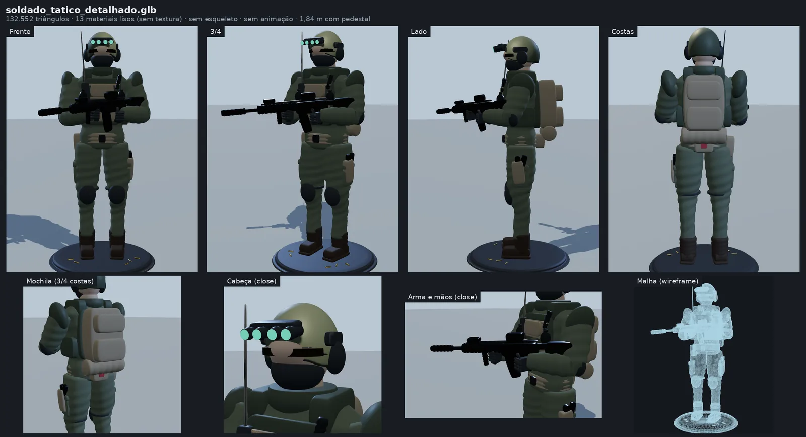

# Soldado tático (modelo do dono do canal)

Modelo 3D criado pelo próprio dono do canal (autoria dele, sem restrição de licença).
Guardado aqui **sem nenhuma alteração** para servir de base para melhorias.

| | |
|---|---|
| Arquivo | `soldado_tatico_detalhado.glb` (3,2 MB, glTF 2.0) |
| Gerador declarado | "Procedural High-Poly Tactical Soldier Generator" |
| Malha | 13 nós, 132.552 triângulos, 13 materiais de cor lisa (sem textura) |
| Tamanho | 0,87 × 1,84 × 1,17 m (com pedestal e fuzil) |
| Rig / animação | nenhum (0 esqueletos, 0 animações) |

Peças (cada uma é um nó, dá para esconder ou trocar): `Uniform_BDU_Suit`, `Ballistic_Armor_And_Helmet`,
`Tactical_Coyote_Loadout` (mochila e bolsos), `Head_And_Neck_Anatomy`, `Ballistic_Goggles_Visor`,
`NVG_Glowing_Optics`, `Tactical_Polymer_Hardware`, `Combat_Tactical_Boots`, `SOPMOD_Assault_Rifle_And_Sidearm`,
`Tactical_Steel_Ordnance_Details`, `Brass_Casings_And_Pins`, `Tactical_Insignia_Patches`, `Display_Tactical_Pedestal`.

## O que melhorar depois (combinado com o dono)

1. **Rosto:** viseira é uma faixa fina que flutua e serrilha onde cruza a pele; balaclava é meia esfera lisa.
2. **Farda:** anéis ondulados em braços e pernas (efeito "boneco inflado"); refazer com dobras de verdade.
3. **Mãos:** bolotas sem dedos; refazer com dedos e empunhadura.
4. **Fuzil:** quase todo preto liso; dar acabamento (materiais com variação, detalhes legíveis).
5. **Peso da malha:** a maior parte dos 132 mil triângulos está em farda, mochila e ferragens que mal aparecem.
6. **Rig e animação:** tronco, braços e pernas da farda são uma malha só; precisa separar os membros,
   ligar a pele a um esqueleto e reposicionar os braços (hoje já estão fechados no fuzil) para andar, correr e pular.
   O esqueleto e o gerador de animações do personagem `corredor` podem ser reaproveitados.
7. Tirar ou trocar o pedestal e o fuzil conforme o vídeo (a arma realista pode pesar na classificação do YouTube).
