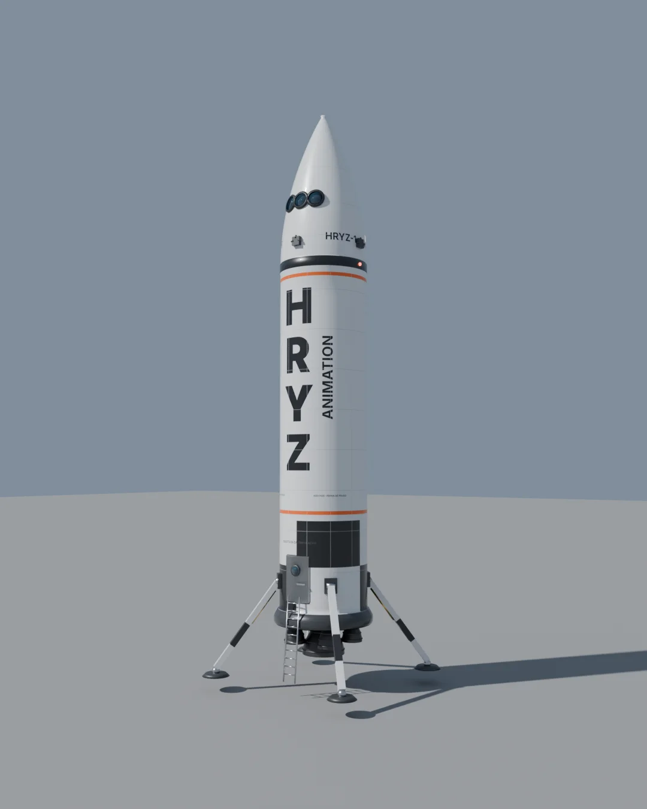
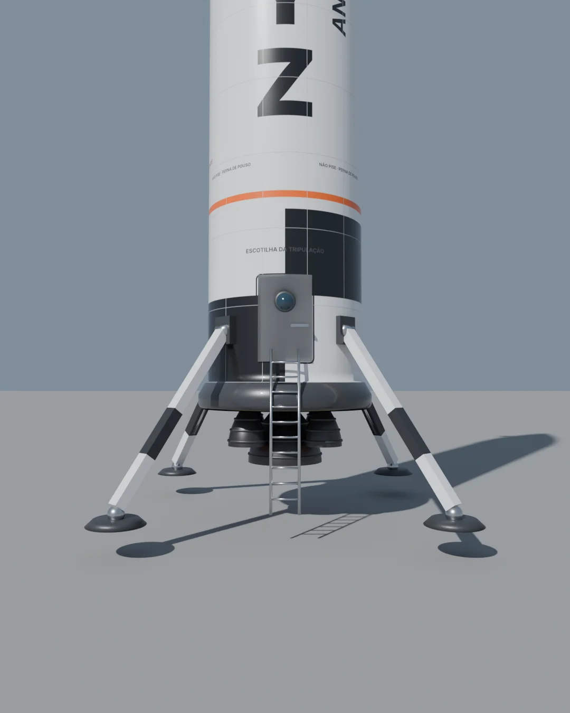
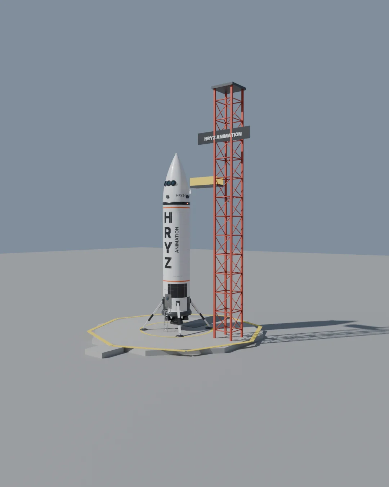

# Foguete HRYZ-1 (lunar) + plataforma de lançamento

Desenho original do canal, feito no Blender por script (`criar_foguete.py`; a pintura vem de `gerar_pintura.py`).





- ~23 m de altura, corpo de 3,6 m, ~28 mil faces, 1,7 MB. Cápsula com 3 janelas, 1 motor central + 4, propulsores de manobra (RCS), antena, luzes de navegação, padrão de rolagem preto e branco, "HRYZ ANIMATION" na vertical.
- A pintura é desenhada em escala real (pixel quadrado na circunferência) e depois reduzida a 4096 × 2048, para as letras não saírem achatadas no corpo.

## Peças móveis (glTF, frente/escotilha = +Z)
| Nó | Como mexe |
|---|---|
| `Perna0`…`Perna3` | eixo local Z: 0 = aberta, +2,45 rad = dobrada junto do corpo |
| `Escotilha` | eixo local Y: 0 = fechada, −1,75 rad = aberta |
| `Bocal` | ponto na saída do motor central (y = 0,75 m), para a chama |

`plataforma_foguete.glb`: base octogonal de 23 m e 0,6 m de altura com rampa, círculo e faixas amarelas, canaleta do fogo, torre treliçada de 30 m com braço de acesso, luz e a placa HRYZ ANIMATION. O foguete fica em y = 0,6.

```
python3 gerar_pintura.py
blender -b -P criar_foguete.py -- [--render previas --amostras 48 --vistas tq,frente,base,pad]
```
